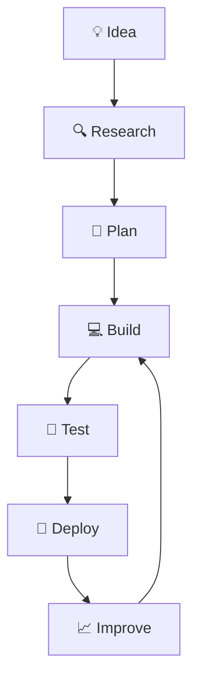

<!-- ======================================================= -->
<!--                    PROFILE HEADER                        -->
<!-- ======================================================= -->

<div align="center">


<br/>


<br/><br/>

<a href="https://github.com/pranjaldubey009">

</a>

<a href="https://learniq-abhi.vercel.app/">

</a>

</div>

<!-- ======================================================= -->
<!--                    ABOUT                                 -->
<!-- ======================================================= -->

<br/>

<div align="center">

### `> whoami`

**Developer • Learner • Builder**

</div>

I'm a developer from India interested in software development, artificial intelligence, modern web technologies and building useful digital products.

I enjoy experimenting with technologies, exploring new ideas and transforming concepts into working applications.

```bash
$ whoami
Abhiman Dubey

$ location
Lucknow, India

$ focus
Software Development | AI | Web

$ mindset
Learn → Build → Improve → Repeat
```

---

<!-- ======================================================= -->
<!--                    ABOUT ME                              -->
<!-- ======================================================= -->

## 🧑‍💻 About Me

- 🌍 Based in India.
- 💻 Interested in modern software engineering.
- 🤖 Exploring AI-powered applications.
- 🚀 Building projects to learn by doing.
- 🧠 Improving programming and problem-solving skills.
- 🔍 Exploring new frameworks, tools and workflows.
- 🛠️ Interested in full-stack application development.
- 📚 Learning through experimentation and real projects.
- ⚡ I prefer building things over just watching tutorials.
- 🎯 Working towards becoming a stronger software developer.

---

<!-- ======================================================= -->
<!--                    CURRENT FOCUS                         -->
<!-- ======================================================= -->

## 🎯 Current Focus

<table>
<tr>
<td width="50%" valign="top">

### 🌐 Web Development

- Frontend architecture
- Responsive interfaces
- Modern JavaScript
- React ecosystem
- Next.js
- TypeScript

</td>

<td width="50%" valign="top">

### 🤖 Artificial Intelligence

- AI integrations
- AI-powered tools
- Prompt engineering
- AI-assisted development
- Intelligent application workflows

</td>
</tr>

<tr>
<td width="50%" valign="top">

### ⚙️ Backend Development

- API development
- Databases
- Server-side logic
- Authentication
- Application architecture

</td>

<td width="50%" valign="top">

### 📈 Developer Growth

- Git & GitHub
- Problem solving
- Project development
- Software fundamentals
- Open source exploration

</td>
</tr>
</table>

---

<!-- ======================================================= -->
<!--                    TECH STACK                            -->
<!-- ======================================================= -->

## 🛠️ Tech Stack & Tools

### 💻 Programming Languages

<div align="center">


</div>

### 🌐 Frontend Development

<div align="center">


</div>

### ⚙️ Backend & Database

<div align="center">


</div>

### 🔧 Tools & Platforms

<div align="center">


</div>

---

<!-- ======================================================= -->
<!--                    LANGUAGES                             -->
<!-- ======================================================= -->

## 🧩 Languages I Work With

<table>
<tr>
<th>Language</th>
<th>Area</th>
<th>Learning / Usage</th>
</tr>

<tr>
<td>Python</td>
<td>Programming & Automation</td>
<td>Projects and experimentation</td>
</tr>

<tr>
<td>C</td>
<td>Programming Fundamentals</td>
<td>Logic and core concepts</td>
</tr>

<tr>
<td>JavaScript</td>
<td>Web Development</td>
<td>Interactive web applications</td>
</tr>

<tr>
<td>TypeScript</td>
<td>Modern Web Development</td>
<td>Typed application development</td>
</tr>

<tr>
<td>HTML5</td>
<td>Frontend</td>
<td>Web structure</td>
</tr>

<tr>
<td>CSS3</td>
<td>Frontend</td>
<td>Styling and layouts</td>
</tr>

<tr>
<td>SQL</td>
<td>Database</td>
<td>Data queries and management</td>
</tr>

</table>

---

<!-- ======================================================= -->
<!--                    FEATURED PROJECTS                     -->
<!-- ======================================================= -->

## 🚀 Featured Projects

<div align="center">

### 🧠 LearnIQ

<a href="https://learniq-abhi.vercel.app/">

</a>

<a href="https://github.com/pranjaldubey009/LearnIQ">

</a>

</div>

**LearnIQ** is a web development project focused on exploring modern digital learning experiences.

- 🌐 Modern web application.
- 💡 Exploring intelligent learning experiences.
- 🛠️ Built with modern development technologies.
- 🚀 Deployed on Vercel.

---

### 💪 SyncFit

<a href="https://github.com/pranjaldubey009/syncfit-habits">

</a>

**SyncFit** is a fitness and habit tracking application concept designed to help users build consistency and track daily routines.

- 📅 Habit tracking.
- 💪 Fitness routines.
- 📱 Progressive Web App exploration.
- 📊 Personal productivity and consistency.

---

### 🧪 Developer Experiments

I also work on experiments, prototypes and smaller projects to explore:

- Modern frameworks.
- AI development workflows.
- APIs and integrations.
- Web interfaces.
- Database technologies.
- Software development concepts.

---

<!-- ======================================================= -->
<!--                    PROJECT PHILOSOPHY                    -->
<!-- ======================================================= -->

## 💡 How I Build



I believe projects are one of the most effective ways to learn software development.

Instead of only studying technologies individually, I try to combine them into practical experiments and applications.

---

<!-- ======================================================= -->
<!--                    GITHUB STATS                          -->
<!-- ======================================================= -->

## 📊 GitHub Analytics

<div align="center">


</div>

---

## 🔥 Contribution Streak

<div align="center">


</div>

---

<!-- ======================================================= -->
<!--                    CONTRIBUTION GRAPH                    -->
<!-- ======================================================= -->

## 📈 Contribution Activity

<div align="center">


</div>

---

<!-- ======================================================= -->
<!--                    CONTRIBUTION SNAKE                    -->
<!-- ======================================================= -->

## 🐍 Contribution Snake

<div align="center">


</div>

<!-- Snake requires a GitHub Actions workflow to generate -->

---

<!-- ======================================================= -->
<!--                    DEVELOPER QUOTE                       -->
<!-- ======================================================= -->

## 💭 Developer Mindset

<div align="center">


</div>

---

<!-- ======================================================= -->
<!--                    CONNECT                               -->
<!-- ======================================================= -->

## 🌐 Connect With Me

<div align="center">

<a href="https://github.com/pranjaldubey009">

</a>

<a href="https://www.linkedin.com/">

</a>

<a href="https://www.instagram.com/">

</a>

</div>

---

<!-- ======================================================= -->
<!--                    PROFILE VISITOR                       -->
<!-- ======================================================= -->

<div align="center">


</div>

---

<!-- ======================================================= -->
<!--                    FOOTER                                -->
<!-- ======================================================= -->

<div align="center">

### Building things. Learning things. Shipping things.

<sub>Thanks for visiting my GitHub profile.</sub>

<br/><br/>


</div>
