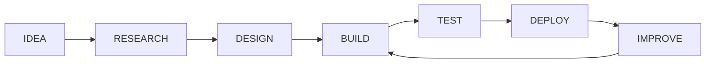

<div align="center">


<br/>

<a href="https://github.com/pranjaldubey009">

</a>

<a href="https://learniq-abhi.vercel.app/">

</a>

</div>

---


# `01 // ABOUT ME`


```yaml
name: Abhiman Dubey
username: pranjaldubey009
location: India

role: Developer & Builder

interests:
  - Software Development
  - AI
  - Full Stack Development
  - Automation
  - Open Source

currently:
  - Building Projects
  - Exploring AI
  - Learning New Technologies
```

I'm a developer who enjoys turning ideas into real digital products.

My interests lie in software development, modern web technologies, artificial intelligence and experimenting with tools that make development smarter and more productive.

- 💻 I build web-based projects.
- 🤖 I explore AI-powered applications.
- 🧠 I learn through experimentation.
- 🚀 I focus on building real projects.
- 🔍 I continuously explore new technologies.

<br clear="right"/>

---


# `02 // CURRENT MISSION`

<div align="center">

| AREA | CURRENT DIRECTION |
|---|---|
| 🌐 Web | Modern web applications |
| 🤖 AI | AI-powered workflows |
| ⚙️ Backend | APIs & application logic |
| 🗄️ Database | Data management |
| 📈 Growth | Engineering fundamentals |
| 🧪 Experiments | Building & testing ideas |

</div>

---

# `03 // TECHNOLOGY MATRIX`

### Languages

<div align="center">


</div>

### Frontend

<div align="center">


</div>

### Backend & Data

<div align="center">


</div>

### Tools

<div align="center">


</div>

---


# `04 // TECH I EXPLORE`

<details>
<summary><b>Programming Languages</b></summary>

- Python
- C
- JavaScript
- TypeScript
- SQL

</details>

<details>
<summary><b>Frontend Technologies</b></summary>

- HTML5
- CSS3
- React
- Next.js
- Tailwind CSS

</details>

<details>
<summary><b>Backend & Database</b></summary>

- Node.js
- Bun
- PostgreSQL
- Prisma
- Supabase
- Firebase

</details>

<details>
<summary><b>Development Tools</b></summary>

- Git
- GitHub
- Visual Studio Code
- Vercel
- Figma
- Canva

</details>

---


# `05 // FEATURED PROJECTS`

<div align="center">

### 🧠 LearnIQ

</div>

A modern web project focused on exploring digital learning experiences and technology-driven learning solutions.

<div align="center">

<a href="https://learniq-abhi.vercel.app/">

</a>

<a href="https://github.com/pranjaldubey009/LearnIQ">

</a>

</div>

**Project interests:**

- Modern web interfaces
- Interactive applications
- AI exploration
- User-focused design

---

<div align="center">

### 💪 SyncFit

</div>

A fitness and habit tracking project exploring how digital tools can help people build better routines and consistency.

**Project focus:**

- Habit tracking
- Routine management
- Web application development
- PWA exploration

<a href="https://github.com/pranjaldubey009/syncfit-habits">

</a>

---

### 🧪 Other Experiments

I also explore ideas involving:

- AI integrations
- Automation
- APIs
- UI experiments
- Developer tools
- Application prototypes

---


# `06 // HOW I BUILD`



I approach projects as a continuous cycle of experimentation.

Rather than stopping at theory, I try to build, test, understand and improve.

---

# `07 // DEVELOPER WORKFLOW`

```text
┌──────────────────────────────────────┐
│              WORKFLOW               │
├──────────────────────────────────────┤
│ 01. Explore the problem              │
│ 02. Research solutions               │
│ 03. Design the architecture          │
│ 04. Build the prototype              │
│ 05. Test and debug                   │
│ 06. Deploy                           │
│ 07. Improve                          │
└──────────────────────────────────────┘
```

---


# `08 // GITHUB STATISTICS`

<div align="center">


</div>

---

# `09 // STREAK`

<div align="center">


</div>

---


# `10 // CONTRIBUTION GRAPH`

<div align="center">


</div>

---

# `11 // CONTRIBUTION SNAKE`

<div align="center">


</div>

---


# `12 // WHAT I BELIEVE`

```text
Curiosity > Comfort

Building > Overthinking

Consistency > Intensity

Learning never stops.
```

---

# `13 // CONNECT`

<div align="center">

<a href="https://github.com/pranjaldubey009">

</a>

<a href="https://www.linkedin.com/">

</a>

<a href="https://www.instagram.com/">

</a>

</div>

---

<div align="center">


<br/><br/>

**`BUILD // LEARN // REPEAT`**

<sub>Thanks for exploring my corner of GitHub.</sub>


</div>
